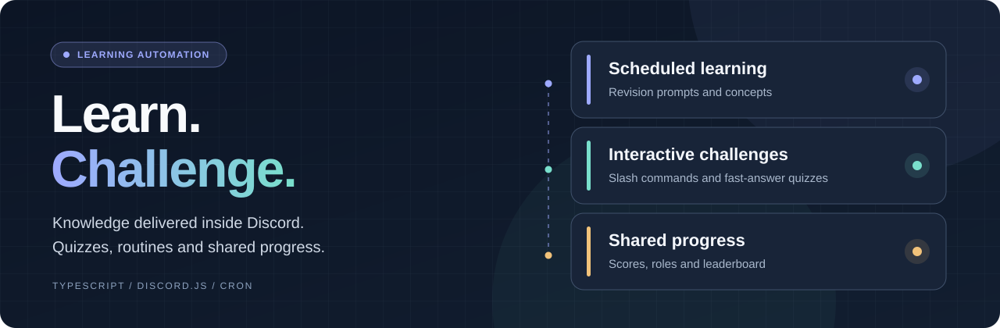

<p align="center"></p>

<h1 align="center">Discord Learning Bot</h1>

<p align="center"><strong>A TypeScript Discord bot that turns RNCP web development revision into scheduled learning prompts and interactive community challenges.</strong></p>

<p align="center"><a href="README.fr.md">Lire en français</a> · <a href="#overview">Overview</a> · <a href="#features">Features</a> · <a href="#architecture">Architecture</a> · <a href="#start">Get started</a> · <a href="#quality">Quality</a> · <a href="#faq">FAQ</a> · <a href="#license">License</a></p>

<p align="center"><a href="LICENSE"></a> </p>

<a id="overview"></a>
## Overview

Discord Learning Bot was built to support group revision for the French RNCP Web and Mobile Web Developer qualification. It posts technical concepts to a designated Discord channel, runs quiz challenges and displays a simple ranking — all from within Discord, without a separate web interface.

**Intended audience :** Developer training groups, learning communities, tutors and Discord server administrators.

**Example workflow:** A scheduled job publishes a web development concept in the discussions channel. A participant launches a challenge with a slash command; the earliest correct response earns a point and an optional Discord role.

<a id="features"></a>
## Features

| Capability | Description |
| --- | --- |
| **Scheduled concepts** | Periodic RNCP revision content posted to a configured discussion channel. |
| **Quiz challenges** | Manual slash command and scheduled challenges. |
| **Scoreboard** | Top-ranked participants based on wins. |
| **Role assignment** | Assign a configured role to the winner of a challenge. |
| **Structured learning data** | Question, concept and score data held in JSON files. |
| **Discord-native interactions** | Slash commands and messages through discord.js. |

<a id="architecture"></a>
## Technical architecture

The project uses TypeScript with Discord.js 14, node-cron jobs, service modules and JSON-based data storage. Source code lives in src/, supporting utilities in lib/, TypeScript types in types/, and questions/concepts/scores in data/. There is no database server or dedicated dashboard.

**Commands:** /challenge starts a quiz and /classement displays the ranking. Scheduling and IDs are configured using environment variables. Deployment requires a running Node.js process connected to Discord's API.

<a id="start"></a>
## Getting started

**Requirements:** Node.js 18 or newer, a Discord application and a server where you can grant the bot the permissions needed for commands, messages and roles. Create a local .env file from the provided example; never commit the bot token.

```bash
git clone https://github.com/hrmonic/discord-learning-bot.git
cd discord-learning-bot
npm ci
cp .env.example .env
# Configure DISCORD_TOKEN, DISCUSSIONS_CHANNEL_ID, WINNER_ROLE_ID
npm run build
npm start
```

On Windows, copy .env.example to .env manually if cp is unavailable. Complete the Discord application registration described in docs/setup.md. A running process is required for the bot to remain online.

<a id="quality"></a>
## Quality, security and limitations

The repository contains Jest tests for answer normalization, JSON reading, validation and leaderboard behavior, plus TypeScript and ESLint scripts. Automated GitHub CI has not been identified in the current repository; tests should be executed locally before deployment.

### Known limitations and safeguards

- Never publish the Discord bot token or other private IDs.
- JSON score storage is suitable for a small community but needs attention to backups and concurrent writes.
- The bot only remains online while its Node.js process is running.
- The learning content focuses on one training context, not a general learning management system.

### Potential improvements

- Add a basic test/build workflow in GitHub Actions.
- Improve portability beyond the initial RNCP topic catalog.
- Document repeatable bot deployment and persistence backups.

### Further documentation

- [Complete bot setup](docs/setup.md)
- [Commands and behavior](docs/commands.md)
- [Architecture](docs/architecture.md)

<a id="faq"></a>
## Frequently asked questions

### Does this require an external website?

No. Interactions happen within Discord, but a Node.js process must host the bot.

### Can I schedule quiz challenges?

Yes. The repository includes node-cron jobs and configuration for scheduled activity.

### Where are scores stored?

The project uses JSON files in the data/ directory.

### What is the primary learning audience?

The initial question bank focuses on the RNCP Web and Mobile Web Developer curriculum.

<a id="license"></a>
## License and maintainer

Released under the **[MIT License](LICENSE)**. Use and contributions are subject to that license.

**Maintainer:** [Réda Touzani (@hrmonic)](https://github.com/hrmonic).

---

*A learning-focused automation project combining collaboration, small workflows and practical TypeScript development.*
